# ADEWI-Rwanda System Architecture

The **Agricultural Drought Early-Warning Index (ADEWI)** architecture is designed as a modular, reproducible satellite climate analytics framework for Rwanda.

```mermaid
flowchart TD
    subgraph Ingestion["1. Ingestion Layer"]
        CHIRPS["CHIRPS Pentad Precipitation"]
        MODIS["MODIS MOD13Q1 (NDVI/EVI)"]
        LST["MODIS MOD11A2 (LST)"]
        SM["FLDAS / ESA CCI Soil Moisture"]
        STAC["STAC Planetary Computer Client"]
    end

    subgraph Processing["2. Preprocessing & Quality Control"]
        QC["Quality Screening & Bounds Check"]
        SCHEMA["Schema & Integrity Validator"]
        CACHE["DAG Checkpoint & Hash Cache"]
    end

    subgraph Analytics["3. Analytics & Indices"]
        CLIM["16-Day Climatological Normalization"]
        ZSCORE["Standardized Anomalies (Z-scores)"]
        INDICES["Standardized Indices (VCI, TCI, VHI)"]
        SPEI["SPEI & Climatic Water Balance"]
        WEIGHT["Dynamic Weight Optimization (PCA / Entropy)"]
        ADEWI["ADEWI Early-Warning Index"]
        CADI["CADI Combined Status Index"]
    end

    subgraph Modeling["4. Predictive & Diagnostic Modeling"]
        RUN["Yevjevich Run Theory Event Extraction"]
        ML["ML Early-Warning Classifier (RF/GB)"]
        AR["AR(p) & Exponential Smoothing Forecaster"]
        ROC["ROC-AUC & Precision-Recall Suite"]
        LEAD["Lead-Time & False Alarm Analysis"]
    end

    subgraph Serving["5. Interfaces & Delivery"]
        UI["Interactive Streamlit Explorer"]
        API["FastAPI REST Microservice"]
        CLI["Rich Multi-Command CLI"]
        REPORTS["Automated LaTeX / Markdown Reports"]
    end

    Ingestion --> Processing
    Processing --> Analytics
    Analytics --> Modeling
    Modeling --> Serving
```

## Architectural Modules

| Layer | Module Path | Purpose |
|---|---|---|
| **Standardized Indices** | `src/adewi/standardized_indices.py` | VCI, TCI, and VHI implementation |
| **Water Balance** | `src/adewi/water_balance.py` | Potential evapotranspiration and multi-scalar SPEI |
| **Weighting Engine** | `src/adewi/weighting.py` | PCA and Shannon Entropy dynamic weighting |
| **Event Analytics** | `src/adewi/events.py` | Yevjevich run-theory event duration and severity |
| **ML Early Warning** | `src/adewi/ml_early_warning.py` | RandomForest & GradientBoosting lead-time classifier |
| **Forecasting** | `src/adewi/forecasting.py` | Autoregressive AR(p) and Holt linear forecasters |
| **Geospatial & Boundaries**| `src/adewi/geography.py` | Rwanda 30-district metadata & GeoJSON generation |
| **Zonal Statistics** | `src/adewi/spatial.py` | Gridded raster masking & zonal drought area fraction |
| **Connectors** | `src/adewi/connectors/` | Real-time CHIRPS and STAC satellite clients |
| **REST Service** | `app/api.py` | FastAPI asynchronous drought warning endpoints |
| **Pipeline Cache** | `src/adewi/caching.py` | SHA-256 DAG hash checkpointing |
| **Schema Validation** | `src/adewi/schema.py` | Strict physical bounds and missing value checks |
| **Telemetry** | `src/adewi/logger.py` | Structured JSON logging and timing profiler |
| **Reporting** | `src/adewi/reports.py` | Automated LaTeX booktabs and executive summaries |
